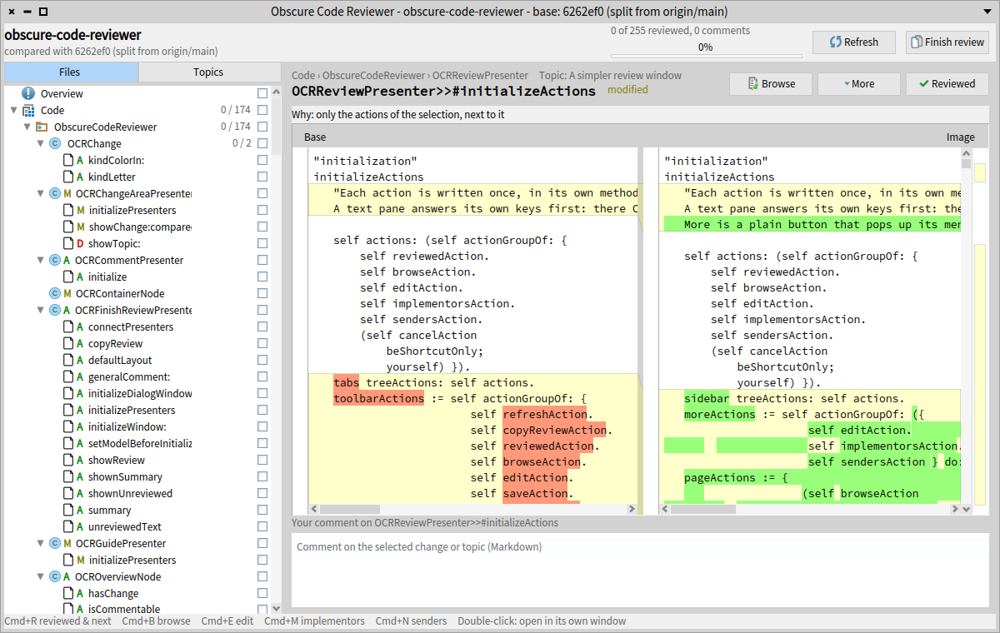
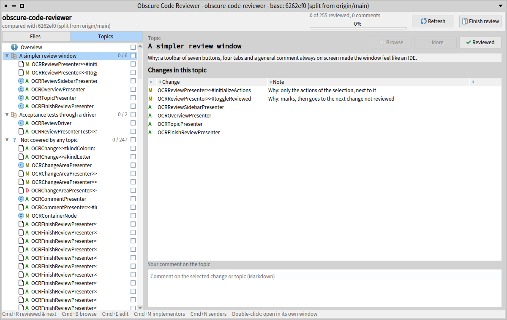
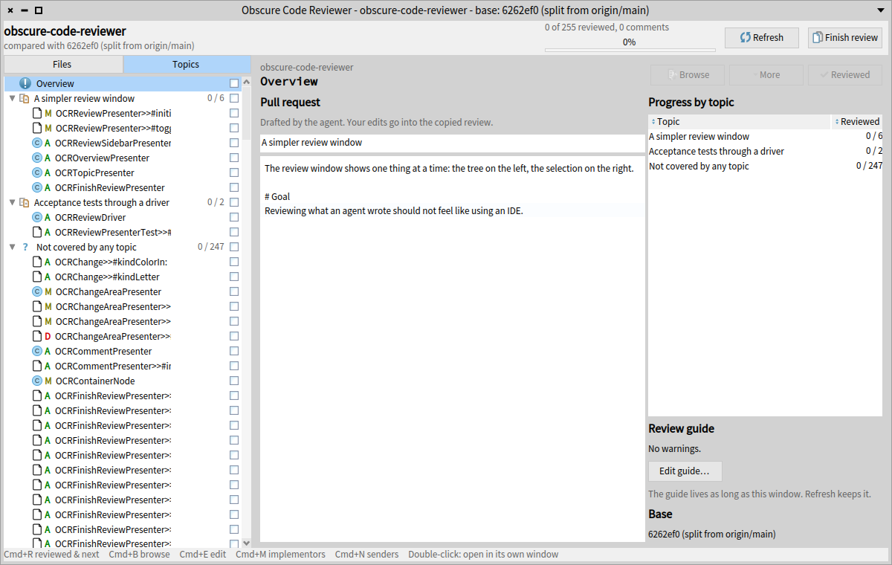
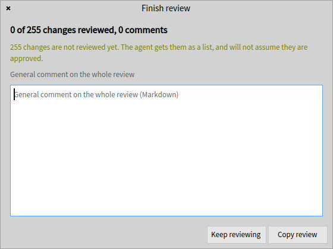

# Obscure Code Reviewer

<p align="center">
  
  <br>
  <em>Left: the agent codes and you don't understand. Right: you review it with this tool.</em>
</p>

Review code changes inside a Pharo image. Built for reviewing what a coding agent wrote, but it works without one.

It shows everything between a base commit and the image, organized in a tree. You read the diffs, mark what you reviewed, write comments, then click **Finish review** and **Copy review** to get Markdown you can paste back to the agent.

<p align="center">
  
</p>

## Install

It needs **Pharo 15**: the window relies on Spec 15.

```smalltalk
Metacello new
	baseline: 'ObscureCodeReviewer';
	repository: 'github://jordanmontt/obscure-code-reviewer:main/src';
	load.
```

## Open it

- World menu: **Browse → Obscure Code Reviewer**. Pick a repository and what to compare it with, then **Open review**.
- Or from a Playground:

```smalltalk
(OCRReviewPresenter onRepositoryNamed: 'my-project') open.
```

The repository must be registered in Iceberg, with a local checkout and its packages loaded.

## What you review

Everything between a **base commit** and the **image**, including changes not committed yet:

- the code of the loaded packages (methods, class definitions, class comments);
- the other files of the repository (README, docs, packages not loaded), compared with the disk. A brand-new file shows up once it is added or committed. Markdown files are rendered with Microdown, both versions side by side, or, with **Source**, shown as a text diff; when Microdown cannot render a file, its source is shown with the reason. Binary files (pictures, videos, archives) show their sizes instead of a diff, and pictures are shown side by side.

The base is chosen for you (the window title says which one):

| You are | Base | You review |
|---|---|---|
| On a branch, and the project has `main` or `master` | where the branch split from it | the whole branch, like a pull request |
| On `main`, with an upstream | where it split from its upstream | what is not pushed yet |
| Anywhere else | the last commit | the uncommitted changes |

The picker lets you choose another base.

**Work on a branch.** On `main`, earlier local commits are mixed into the review until they are pushed. With a branch per task, the review is exactly that task.

## The window

The tree is on the left, expanded, what you selected on the right. The header shows how much you reviewed and commented.

- **Files / Topics:** two ways to walk the changes. **Files** has Code, Tests, Baseline and Files, then package → class → method. **Topics** groups them by purpose, from the agent's review guide (below); changes no topic mentions are under "Not covered by any topic". Each row shows its kind (**A** added, **M** modified, **D** deleted), how much below it is reviewed, whether it is commented, and a checkbox to mark it reviewed.
- **A change:** its diff, or the code alone when it was added or removed, with the agent's note above it and your comment below. **Double-click** a change to open it in its own large window, for long lines and long methods.
- **Reviewed** (Cmd+R): marks the selected change and goes to the next one not reviewed. On a group or a topic, it marks everything in it; on something already reviewed it reads **Unmark**. A refresh keeps the mark only while the code is the same.
- **Cmd+A** selects every row of the tree (or right-click → **Select all**); **Reviewed** then marks them all. **Review all**, in the header, marks every change of the review at once.
- **Browse** opens the change in the System Browser. **More** has **Edit** (fix an added or modified method by hand, then **Save** or **Cancel**), **Implementors** and **Senders**.
- **A topic:** why the agent made its changes, its changes with their notes, and your comment on the topic.
- **Overview** (the first row): the title and description of the future pull request, which the agent drafts and you edit; how much of each topic is reviewed; the guide's warnings, and **Edit guide…** to change it.
- **Refresh:** recomputes everything, keeping your comments, marks and pull request edits.
- **Finish review:** a general comment on the whole review, then **Copy review**: your comments as Markdown, with the changes not reviewed yet and your pull request edits.

Comments and marks live in memory while the window is open.

<p align="center">
  
  <br>
  
  <br>
  
</p>

## The review guide (for agents)

The agent gives a Markdown guide to the review window when it opens it (for example over MCP). The guide is not stored: it lives as long as the window.

```smalltalk
(OCRReviewPresenter
	onRepositoryNamed: 'my-project'
	guide: (OCRReviewGuide fromText: 'Title: Parse tokens lazily
The parser read the whole stream for every token.

# Goal
`MyParser>>#nextToken` reads one token at a time.

Topics:

# Parse tokens lazily
Why: the stream was re-scanned for every token.
- MyParser>>#nextToken reads one token, not the whole stream
- MyToken
- MyToken>>#value <- MyParser>>#tokenValueAt: extracted from the parser
- README.md')) open
```

- Before the `Topics:` line: the pull request title and description, as written; its `#` headings and `- ` lines are not topics or changes.
- After it, `# ` starts a topic, the lines below explain it, `- ` lines list its changes.
- After a change: why it was made, and `<- Other>>#ref` when its code was moved from another change (the diff then compares with that code).

The `pharo-review` agent skill describes the whole workflow; `DESIGN.md` describes the tool in detail.
## Development

- Packages: `ObscureCodeReviewer` (Model and UI tags), `ObscureCodeReviewer-Tests`, `BaselineOfObscureCodeReviewer`.
- Only `OCRIcebergReader` knows Iceberg; everything else works on plain `OCRChange` and is tested without a repository.
- Run the tests in `ObscureCodeReviewer-Tests`.

## License

MIT
